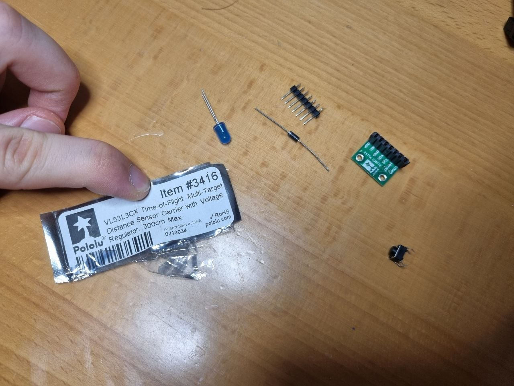
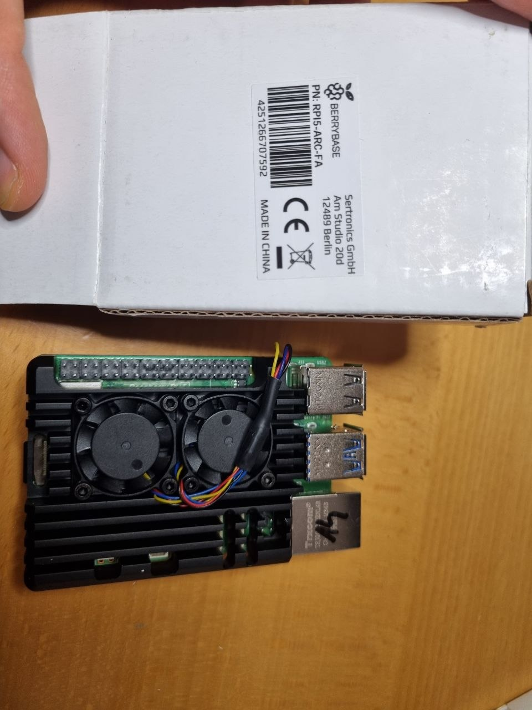

# VL53L3CX ToF distance monitor

Embedded Systems project, M.Sc. Mechatronik, FH Wiener Neustadt, SS 2026.

A VL53L3CX time-of-flight sensor sits on a Raspberry Pi 5 (I2C). The Pi only measures and sends the values over TCP. A PyQt6 window on the laptop shows the distance and a live graph. Range mode and timing budget can be changed from the GUI while it runs.

<p>
  
  
</p>

Pololu VL53L3CX carrier (#3416) and the Pi 5 in its case. More photos in [electronics_imgs](electronics_imgs/).

## Why Pi + laptop

The sensor has to be on the Pi, I2C is a board bus. Drawing the GUI on the Pi over remote desktop was slow, so the Pi only does the measuring and the laptop does the drawing. Anything that gives an IP link works: LAN, Wi-Fi or a direct USB-C cable (Ethernet gadget mode).

```
VL53L3CX  --I2C 0x29-->  Pi 5: sensor_server.py  --TCP 9999-->  laptop: main.py <PI_IP>  (PyQt6 GUI)
```

The Pi runs normal Raspberry Pi OS, no PREEMPT_RT kernel. The sensor gives at most 30 Hz and the GUI is fine with 50 to 100 ms delay, reasons in [docs/real_time_decision.md](docs/real_time_decision.md).

## Wiring

| VL53L3CX | Pi 5 header |
|---|---|
| VIN | 3V3 (pin 1) |
| GND | GND (pin 6) |
| SDA | GPIO2 / SDA1 (pin 3) |
| SCL | GPIO3 / SCL1 (pin 5) |

The carrier has its own regulator and pull-ups, its I/O is 3.3 V like the Pi.

## Protocol

One TCP connection, request and answer:

- laptop sends `r`, Pi answers `<distance_mm>,<status>\n`
- laptop sends `c<mode>,<budget_us>\n`, Pi re-arms the sensor with the new settings and answers `ok\n`

```
r            ->  412,0       412 mm, ok
c1,33000     ->  ok          short range, 33 ms budget
```

Status: 0 ok, 1 error, 2 not ready yet, 4 no target. A reading counts as valid with status 0 and 0 < distance < 6000 mm.

The sensor sometimes has no new frame when the GUI asks. Then the last valid value is used again if it is younger than 0.5 s, before that the display jumped to 0 all the time.

## Running it

On the Pi:

```bash
sudo raspi-config                      # Interface Options -> I2C -> enable, reboot
sudo apt install i2c-tools python3-venv build-essential python3-dev git
python3 -m venv .venv && source .venv/bin/activate
pip install -r requirements-rpi.txt    # builds the native VL53L3CX driver
i2cdetect -y 1                         # sensor has to show up at 0x29
python src/sensor_server.py
```

On the laptop (`hostname -I` on the Pi gives the IP):

```powershell
python -m venv .venv
.\.venv\Scripts\activate
pip install -r requirements.txt
python src\main.py 10.42.0.1
```

## Files

```
src/main.py               laptop side, starts the GUI with a NetworkSensor
src/gui.py                PyQt6 window: big distance value, graph, range and budget dropdowns
src/sensor.py             SensorReading, BaseSensor, VL53L3CXSensor (Pi), NetworkSensor (laptop)
src/sensor_server.py      Pi side, TCP server around the real sensor
src/vl53l3cx_driver.py    ctypes bindings to the ST driver, I2C over smbus2
docs/                     real-time decision, presentation
electronics_imgs/         photos of the parts
```

`vl53l3cx_driver.py` comes from [FrgyCZ/VL53L3CX-python](https://github.com/FrgyCZ/VL53L3CX-python) (MIT).
